# CB File Hub: All-in-One File Manager for Windows, macOS, Linux and Android

**The all-in-one tool for your files and media.** CB File Hub is a tabbed file manager, a photo and video gallery and a **real-time video translator** in one app: watch video in one language and read live subtitles in 38 others, all on your own computer. It also brings an SSH client with SFTP, network shares (SMB, FTP, WebDAV), an AI file assistant, a disk cleaner, file tags and a torrent library, so you do not need a separate tool for each job.

[](https://github.com/coolbirdzik/cb-file-hub/actions/workflows/build-test.yml)
[](https://github.com/coolbirdzik/CB-File-Hub/actions/workflows/release.yml)

<p align="center">
  <a href="https://apps.microsoft.com/detail/9nchpzkc4m5c?referrer=appbadge&mode=full"></a>
  &nbsp;
  <a href="https://play.google.com/store/apps/details?id=com.cbv.filehub"></a>
</p>

<p align="center">
  <a href="https://coolbird.net">Website</a> ·
  <a href="https://github.com/coolbirdzik/cb-file-hub/releases/latest">Download</a> ·
  <a href="docs/index.md">Documentation</a> ·
  <a href="README.vi.md">Tiếng Việt</a>
</p>

<p align="center">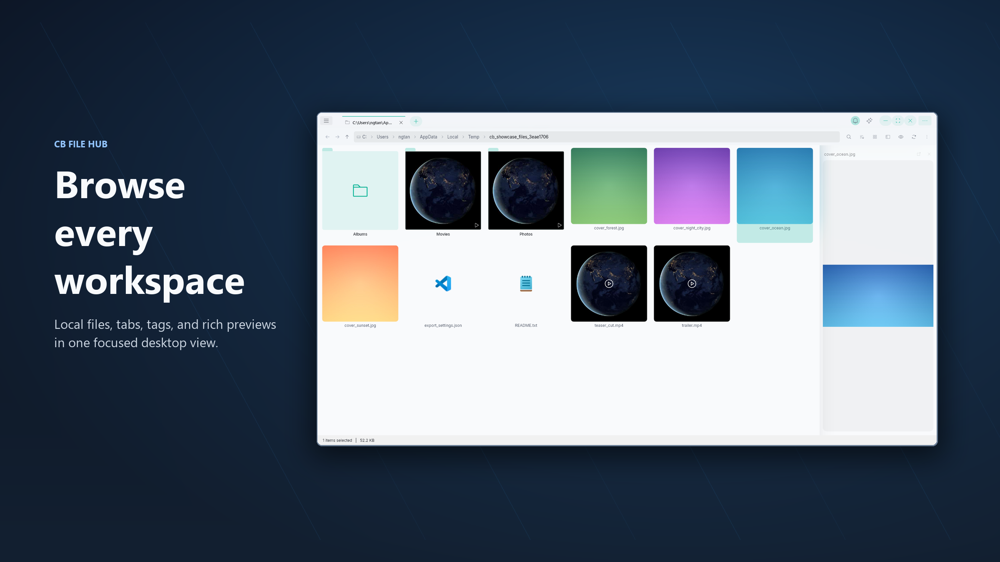</p>

## Real-time video translation, on your desktop

**Watch video in one language and read real-time subtitles in another.** CB File Hub listens to the audio as you play, transcribes it (Japanese, English, Korean, Chinese and many more) and translates it a moment ahead of playback, with recognition and translation running on your own computer. Choose your subtitle language, or follow the app language by default.

<p align="center">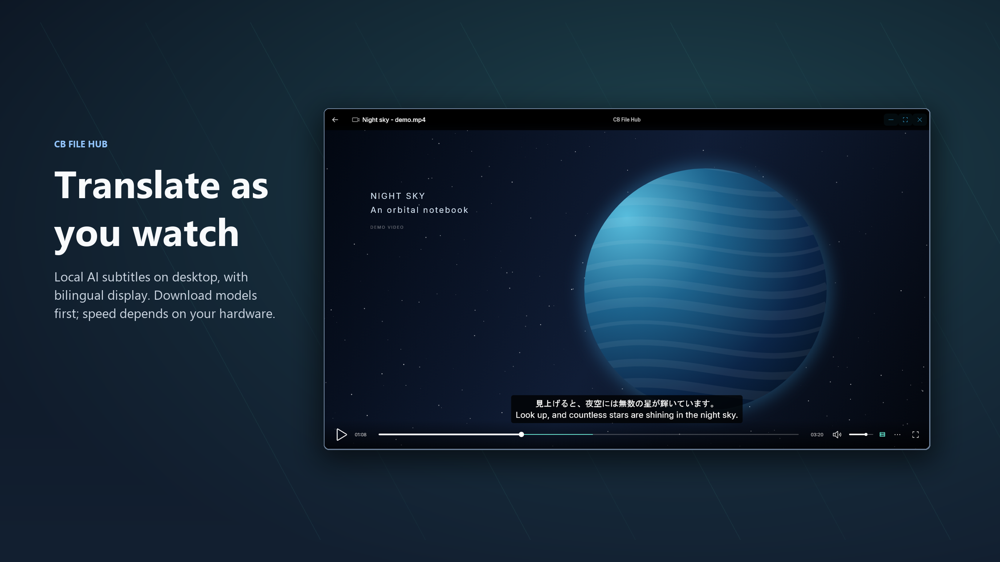</p>

<p align="center">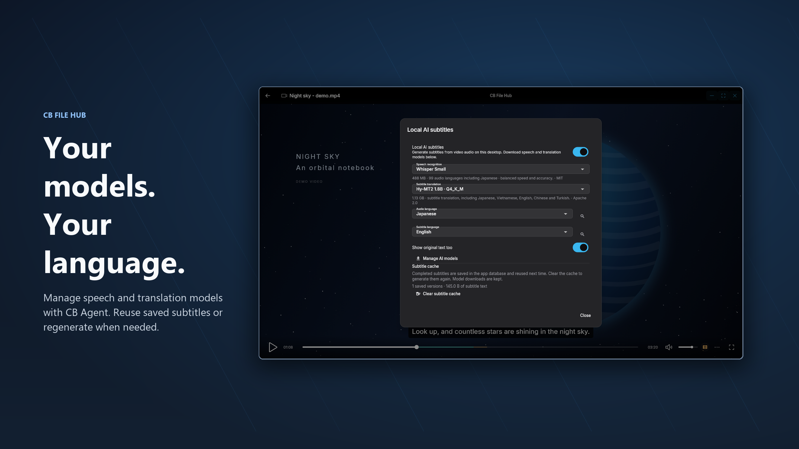</p>

- **Multilingual, in real time:** subtitles appear ahead of the playhead while you watch, and you can show the original and the translation together as bilingual subtitles. Japanese to English or Vietnamese is just one of many pairs.
- **38 target languages:** Arabic, Bengali, Burmese, Cantonese, Chinese (Simplified and Traditional), Czech, Dutch, English, Filipino (Tagalog), French, German, Gujarati, Hebrew, Hindi, Indonesian, Italian, Japanese, Kazakh, Khmer, Korean, Malay, Marathi, Mongolian, Persian, Polish, Portuguese, Russian, Spanish, Tamil, Telugu, Thai, Tibetan, Turkish, Ukrainian, Urdu, Uyghur and Vietnamese.
- **100 spoken languages recognized:** Whisper can detect the audio language itself; the speech model you pick limits the list (single-language models accept only their own).
- **Local processing:** download Whisper and the translation model once; local videos can then be subtitled offline. No audio or transcript is sent to a cloud AI service.
- **Built into playback:** one seek track shows playback and AI progress. The small **CC** menu holds status, settings, retry and **Clear and regenerate**.
- **Models in one place:** manage speech, translation and CB Agent downloads together in **Settings → AI models · CB Agent & subtitles**.
- **Ready next time:** completed subtitles are cached in the app's SQLite database and reused when you reopen or seek. Clear a video version or all subtitle cache whenever needed.

**Desktop preview:** requires a desktop build containing this feature and downloaded models. Older releases may not include it. Supports seekable local videos and suitable network VOD; non-seekable live streams are not supported. Real-time speed depends on your hardware and the models you choose; a slower machine may need a moment to get ahead of playback. See [setup, models and cache](docs/features/12-local-ai-subtitles.md).

<details><summary>Models, language choices and saved subtitle cache</summary>
<p align="center">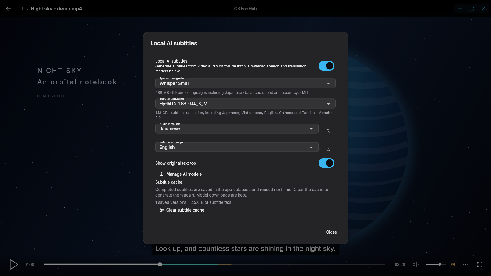</p>
</details>

The screenshots render the app's production widgets with an original demo illustration and authored subtitle data. They illustrate the interface, not recognition accuracy or processing speed. [Reproduce the captures and promo images](screenshots/features/local_subtitles/README.md).

## Features

### Media gallery: photos, videos and tags
Gallery and video library, built-in player with picture-in-picture, image editor, albums and rule-based smart albums, and hierarchical tags you can search across every folder.

<table>
  <tr>
    <td width="50%">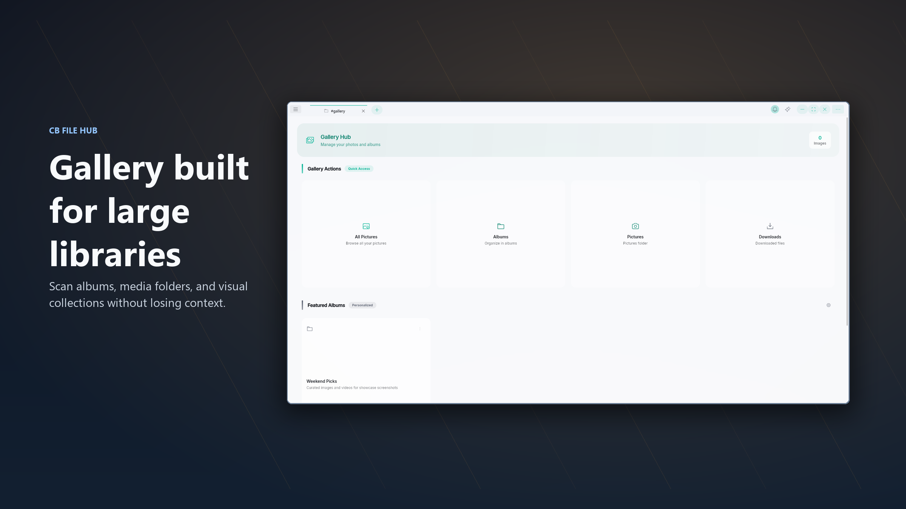</td>
    <td width="50%">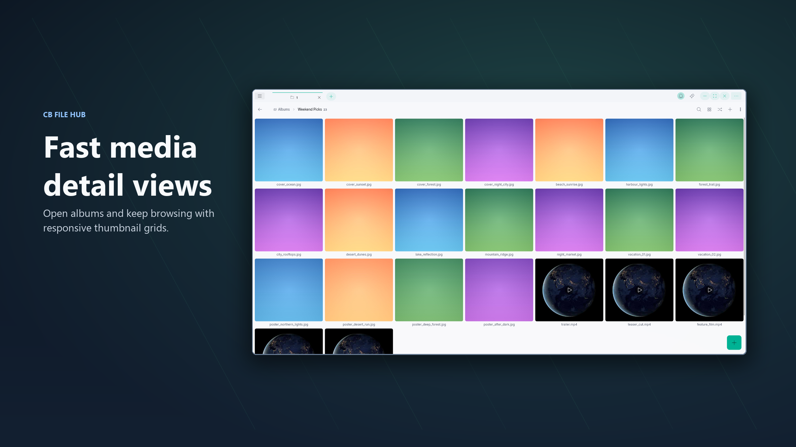</td>
  </tr>
</table>

### File manager
Tabs and tear-off windows, split panes, grid and list views with previews, pinned locations, keyboard shortcuts and a fast recursive search.

Open archives like folders and extract selected items or everything. ZIP, 7z, TAR (including .tar.gz, .tar.bz2 and .tar.xz), GZip and BZip2 work on Windows, macOS, Linux and Android without extra tools. RAR needs 7-Zip installed, so it works on Windows only. Settings and tags can be exported to a ZIP backup.

### CB Agent: AI file assistant
Ask in plain language: *"find duplicate videos"*, *"show large files from last year"*, *"tag these photos"*. The agent searches file names and document text, explains what it found and **asks before it moves, renames or deletes anything**. Use OpenAI, Anthropic, OpenRouter, Ollama or LM Studio, or run a local GGUF model on your own device with no cloud.

### SSH manager and network files
- **SSH client:** saved hosts and keys, built-in terminal, trusted hosts, connections through HTTP or SOCKS proxies.
- **SFTP:** browse and transfer files on your servers.
- **SSH tunnels:** local, remote and SOCKS5 port forwarding.
- **Import:** hosts from Termius, OpenSSH, PuTTY, WinSCP, SecureCRT and Tabby.
- **Network shares:** SMB/CIFS, FTP and WebDAV, with media streaming from network shares.

### Disk cleaner
Smart Clean removes only junk that apps can recreate: temporary files, browser and app caches, crash dumps, and developer caches (npm, pip, Cargo, Gradle, Go, Xcode, editor logs and VSIX downloads). Disk usage shows a full-drive tree, and you review every item before it goes to the Recycle Bin or Trash. The Apps page lists every installed app with its size on Windows, macOS and Linux. It also shows when each app was last opened (from Windows launch history or Spotlight on macOS) and can uninstall apps: on Windows through the app's own uninstaller, on macOS by moving the app to the Trash. Linux shows sizes only.

### App storage: what each app keeps on disk

App storage lists every installed app with what it keeps on disk: the app itself, caches, logs, crash reports, web storage and its own data. It also shows how much of that is safe to remove. It is available on Windows, macOS and Linux. Folders are matched to apps the same way the Leftover app data page matches them, so folders that belong to no installed app stay on that page.

- **Safe to clean, checked for you:** caches that an app rebuilds when it starts (Chromium and Electron apps such as Slack, Teams, Discord and editors), logs from earlier sessions and old crash dumps.
- **Opt-in:** a whole `Caches/<app>` or log folder. The app downloads or rebuilds it, but may start slower.
- **Only shown, never cleaned:** documents, sandbox containers, data shared between apps of the same vendor, web storage and settings.
- **Running apps:** their caches are kept. On macOS and Linux this is detected from the running processes; on Windows, from the app's executable names.
- **Code editors:** VS Code, Cursor, VSCodium, Windsurf, Antigravity and Kiro also list each extension with its icon, install size and stored data, plus old extension versions and data of deleted workspaces.
- **Docker:** images, containers, volumes and build cache, read through Docker's own CLI. Build cache and untagged images start checked. Unused images and stopped containers are opt-in, and unused volumes are opt-in with a warning that their data is deleted for good. Docker removes them itself after a confirmation; nothing goes to the Trash.

<p align="center">
  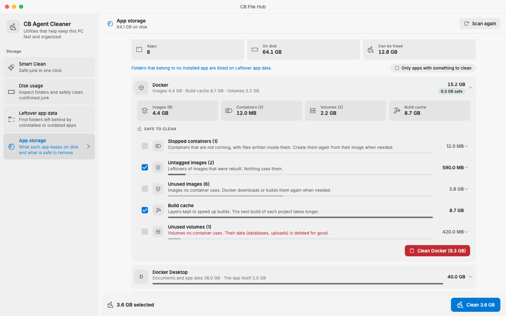
</p>

Results appear as soon as the data folders are measured; the size of each app itself follows. Folder sizes come from one Rust walk, with a Dart fallback. Everything you clean goes to the Recycle Bin or Trash as a whole folder.

<table>
  <tr>
    <td width="33%">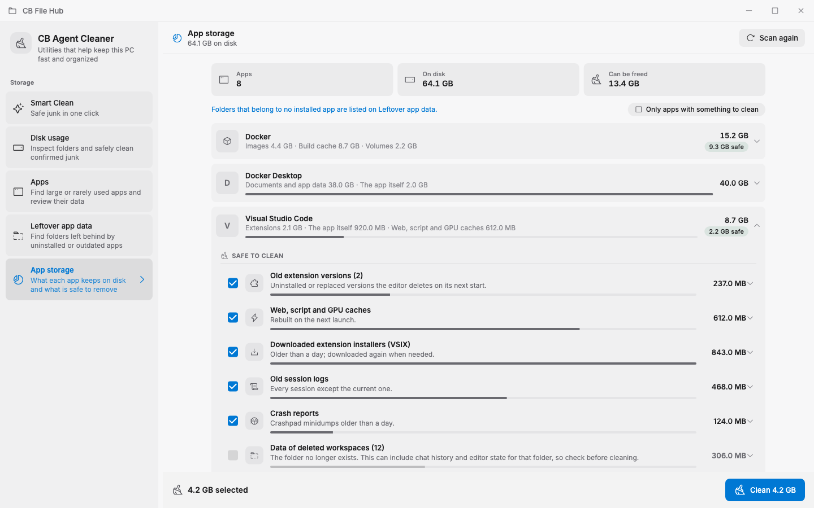<p align="center">Windows</p></td>
    <td width="33%">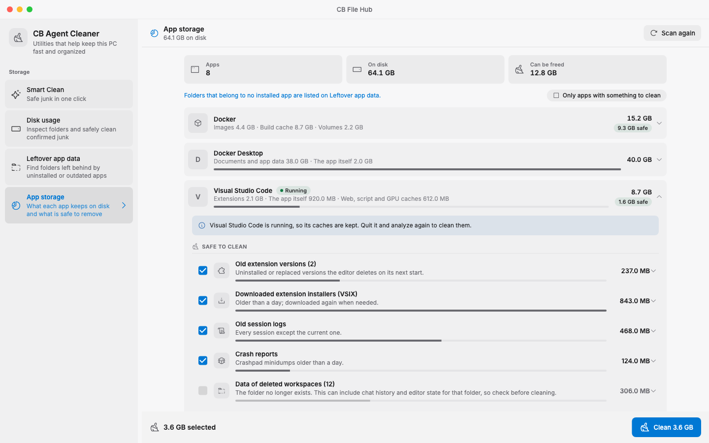<p align="center">macOS</p></td>
    <td width="33%">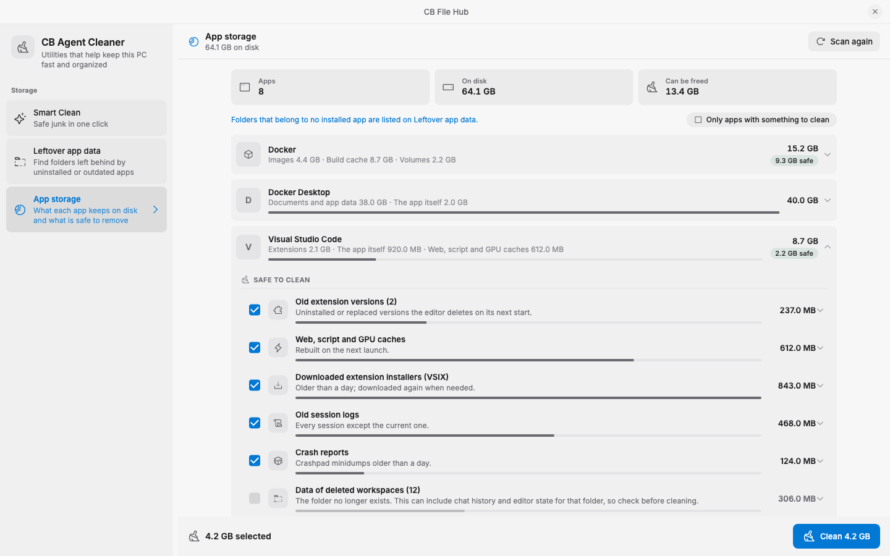<p align="center">Linux</p></td>
  </tr>
</table>

### Choose which moment appears in video thumbnails

**You choose which point in a video becomes its thumbnail:** 10%, 20%, 50%, or another percentage of its duration. For example, choosing 20% for a ten-minute video uses a frame around the two-minute mark.

Go to **Settings → Video Thumbnails → Custom** and adjust **Thumbnail position** to choose the moment shown in your previews. Fast mode uses the operating system's thumbnail method instead. You can also set the maximum number of parallel tasks.

Viewport loading is on by default: only visible videos and a few nearby items get thumbnails generated, reducing background CPU and disk activity in large libraries. Scrolling away or hiding a tab cancels queued work outside that range; decodes already running finish normally. Cached thumbnails are reused when you return. Turn off **Load thumbnails near the viewport** to preload the entire list. [How thumbnail generation works](docs/technical/06-filesystem-media.md#hybrid-thumbnail-generation).

### Torrents and backup
A searchable torrent library with qBittorrent and Transmission import and built-in downloads. Back up settings and tags to Google Drive, Dropbox or OneDrive.

Heavy work (disk scans, search, thumbnails, hashing, archives) runs on Rust worker threads: a full rescan of 100,000 files took **84.9 ms, 3.3× faster than TreeSize Free** in [our benchmark](docs/quality/03-rust-benchmarks.md#folder-scan-ui-comparison-with-treesize-free).

## Screenshots

<table>
  <tr>
    <td width="50%"></td>
    <td width="50%"></td>
  </tr>
  <tr>
    <td width="50%"></td>
    <td width="50%"></td>
  </tr>
  <tr>
    <td width="50%">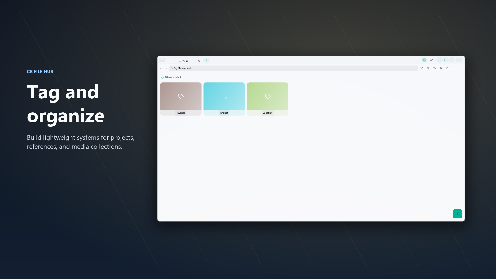</td>
    <td width="50%">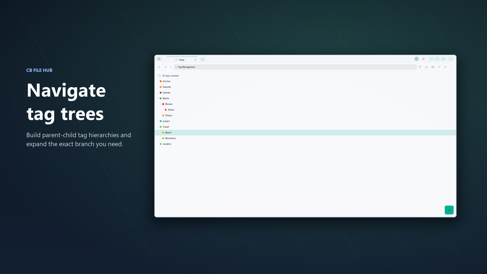</td>
  </tr>
  <tr>
    <td width="50%">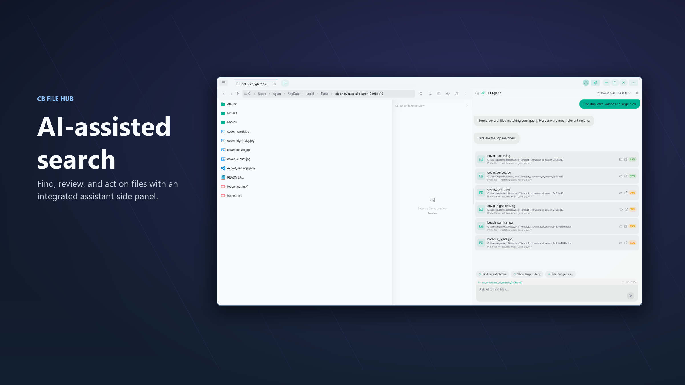</td>
    <td width="50%">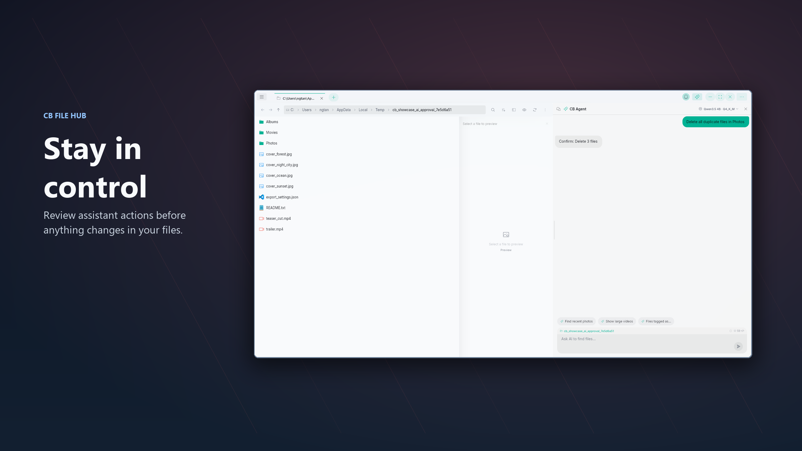</td>
  </tr>
  <tr>
    <td width="50%">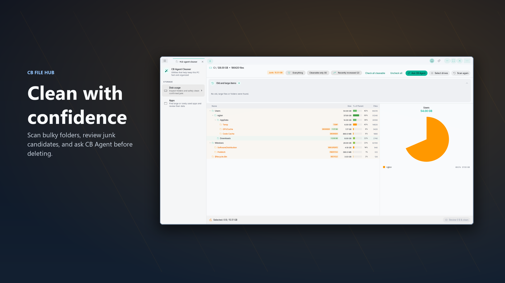</td>
    <td width="50%">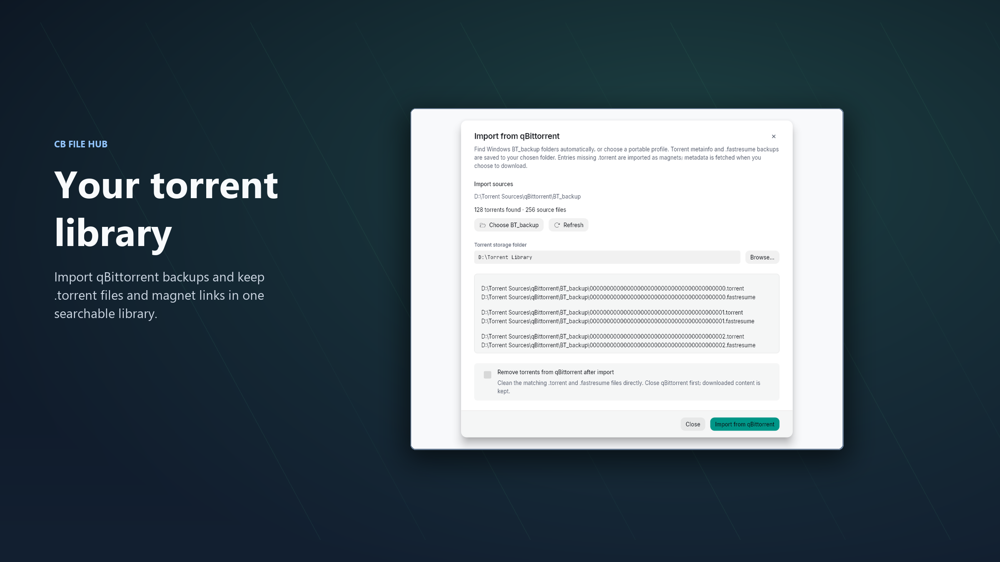</td>
  </tr>
</table>

<p align="center">
  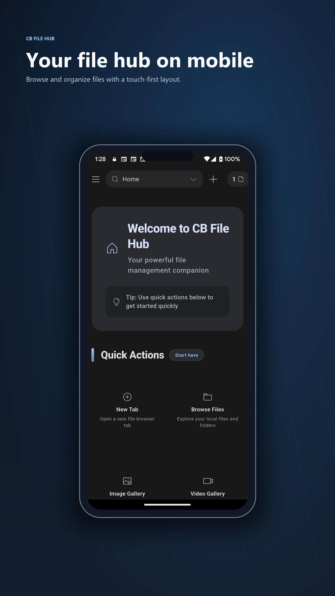
  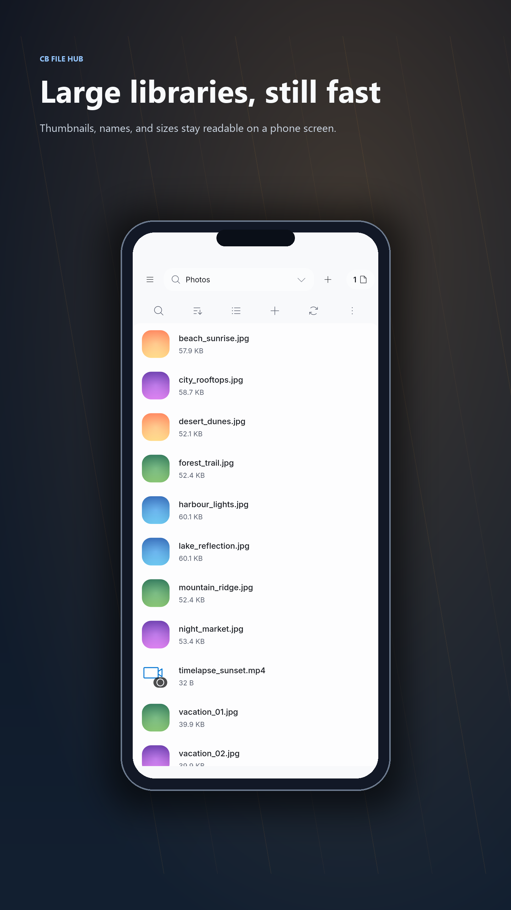
  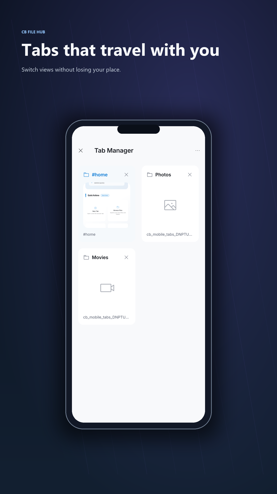
  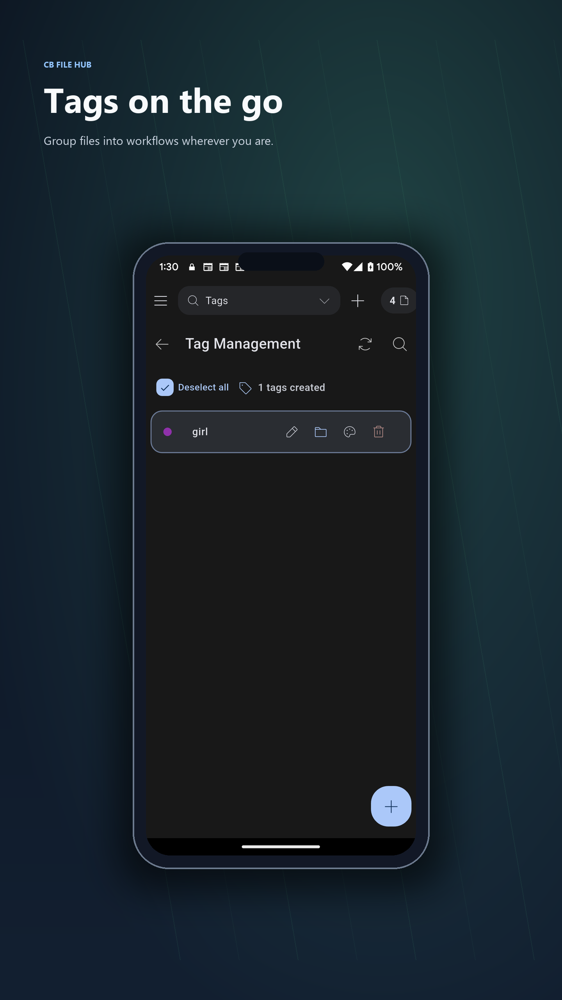
</p>

[More screenshots](screenshots/)

## Download

| Platform | Get CB File Hub |
|----------|-----------------|
| **Windows** | [Microsoft Store](https://apps.microsoft.com/detail/9nchpzkc4m5c), or the [MSI installer / portable ZIP](https://github.com/coolbirdzik/cb-file-hub/releases/latest) |
| **macOS 12+** | [Universal DMG](https://github.com/coolbirdzik/cb-file-hub/releases/latest) for Apple Silicon and Intel |
| **Linux** | [.deb for Debian/Ubuntu, or tar.gz](https://github.com/coolbirdzik/cb-file-hub/releases/latest) |
| **Android** | [Google Play](https://play.google.com/store/apps/details?id=com.cbv.filehub) or [APK](https://github.com/coolbirdzik/cb-file-hub/releases/latest) |

Some features depend on the platform; see the [installation guide](docs/guides/04-installation.md) and the [feature guides](docs/features/).

## Build from source

Requires **Flutter 3.47.8 stable** and [`just`](https://github.com/casey/just):

```bash
git clone https://github.com/coolbirdzik/cb-file-hub.git
cd cb-file-hub
just deps
```

See [development setup](docs/contributing/04-development-setup.md) for each platform's toolchain, builds and tests.

The App storage screenshots are rendered from the app's widgets with sample data, without reading any app folder. To rebuild them for Windows, macOS and Linux in English and Vietnamese, run this from `cb_file_manager/`:

```bash
flutter test --no-pub tool/capture_app_storage_screenshots_test.dart --dart-define=CB_CAPTURE_SCREENSHOTS=true
```

## Contributing

[Open an issue](https://github.com/coolbirdzik/cb-file-hub/issues) for bugs and feature requests, or send a pull request. Start with the [contribution guide](docs/contributing/01-contribution-guide.md) and the [technical docs](docs/technical/index.md).
