# CB File Hub

**Your ALL-IN-ONE file manager for Windows, macOS, Linux, and Android.**

Files, media, network access, torrents, backups, storage cleanup, and AI assistance — together in one app across desktop and mobile.

[](https://github.com/coolbirdzik/cb-file-hub/actions/workflows/build-test.yml)
[](https://github.com/coolbirdzik/CB-File-Hub/actions/workflows/release.yml)

<p align="center">
  
</p>

<table align="center">
  <tr>
    <td align="center" valign="middle">
      <a href="https://apps.microsoft.com/detail/9nchpzkc4m5c?referrer=appbadge&mode=full" target="_blank" rel="noopener noreferrer">
        
      </a>
    </td>
    <td align="center" valign="middle">
      <a href="https://play.google.com/store/apps/details?id=com.cbv.filehub" target="_blank" rel="noopener noreferrer">
        
      </a>
    </td>
  </tr>
</table>

[Website](https://coolbird.net) · [Releases](https://github.com/coolbirdzik/cb-file-hub/releases/latest) · [Documentation](docs/index.md) · [Tiếng Việt](README.vi.md)

## Platforms

| Platform | Get the app |
|----------|-------------|
| **Windows** | [Microsoft Store](https://apps.microsoft.com/detail/9nchpzkc4m5c) or [MSI / portable ZIP](https://github.com/coolbirdzik/cb-file-hub/releases/latest) |
| **macOS** | [Universal DMG](https://github.com/coolbirdzik/cb-file-hub/releases/latest) for Apple Silicon and Intel, macOS 12+ |
| **Linux** | [Build from source](docs/guides/04-installation.md#linux) |
| **Android** | [Google Play](https://play.google.com/store/apps/details?id=com.cbv.filehub) or [APK](https://github.com/coolbirdzik/cb-file-hub/releases/latest) |

## Highlights

- **Flexible browsing:** tabs on desktop and mobile, desktop split panes, pinned locations, and multiple file views.
- **Media tools:** thumbnails, photo and video galleries, image editing, and built-in playback.
- **Tags and albums:** hierarchical tags, search, curated collections, and rule-based smart albums.
- **Network and SSH:** SMB, FTP, SFTP, WebDAV, saved hosts, keys, and an in-app terminal.
- **CB Agent:** natural-language file search, guided organization, and cleanup review.
- **Disk Cleaner:** scan large folders, review cleanup candidates, and manage storage on Windows, macOS, and Android.
- **Rust acceleration:** heavy scans, search, thumbnails, hashing, and archive processing run on native worker threads. See [measured performance](#rust-powered-performance).
- **Library tools:** torrent indexing and desktop downloads, archive browsing, settings/tag backups, and themes.

Features vary by platform. See the [feature guides](docs/features/) for requirements and setup.

## Rust-powered performance

CB File Hub uses Rust worker threads for disk scans, folder listings and sizes, recursive search, image thumbnails and editing, hashing, archives, and document text extraction.

**3.3× faster full rescans than TreeSize Free in our 100,000-file benchmark:**

| Application | Scan technology | Full rescan, 100,000 files | Relative speed |
|-------------|-----------------|--------------------------:|---------------:|
| **CB File Hub** | Rust workers + Win32 directory enumeration | **84.9 ms** | **3.3×** |
| TreeSize Free 4.8.1.609 | NTFS MFT / two-thread filesystem traversal¹ | 283.3 ms | 1.0× (baseline) |

Measured on 2026-10-22: Core i5-14600K, NVMe SSD, Windows 11; median of five alternating runs after warm-up, with warm OS caches. CB used its production Cleaner screen in a standalone release benchmark launcher. Both counted 100,000 files and 12,800,000 logical bytes. Results apply to this synthetic folder-scan workflow; whole-drive performance varies. [Timing boundaries, raw samples, screenshots, and reproduction](docs/quality/03-rust-benchmarks.md#folder-scan-ui-comparison-with-treesize-free).

¹ TreeSize's listed technologies are [documented by JAM Software](https://www.jam-software.com/treesize/features.shtml); the internal scan strategy selected during this run was not instrumented.

## Preview

### Desktop workflow

<table>
  <tr>
    <td colspan="4">
      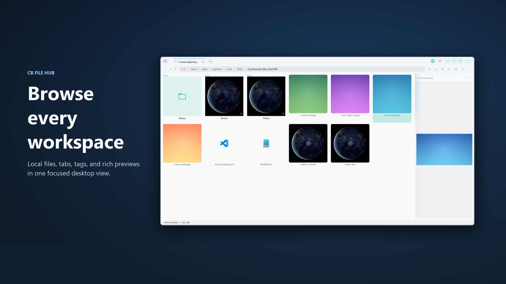
      <p align="center"><sub>Desktop file browsing with tabs, tags, and rich previews</sub></p>
    </td>
  </tr>
  <tr>
    <td colspan="4">
      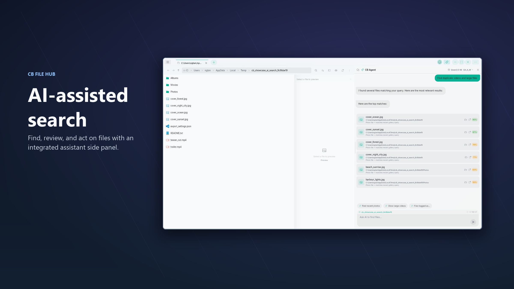
      <p align="center"><sub>AI-assisted search beside the file browser</sub></p>
    </td>
  </tr>
  <tr>
    <td colspan="4">
      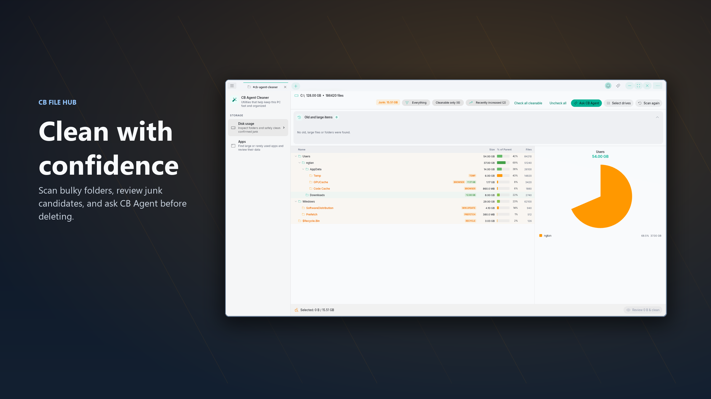
      <p align="center"><sub>Disk cleanup with scan results, category review, and CB Agent guidance</sub></p>
    </td>
  </tr>
  <tr>
    <td align="center" width="50%">
      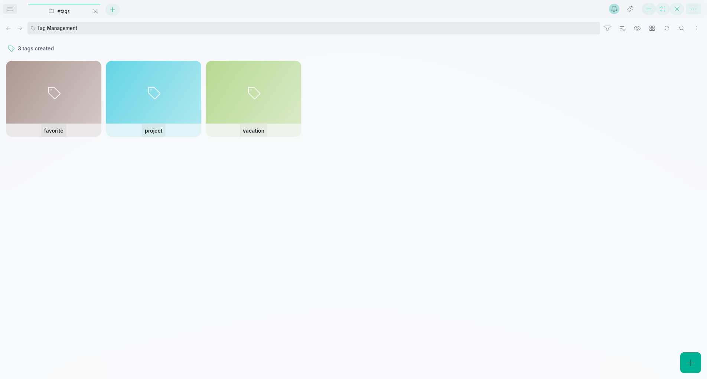
      <p align="center"><sub>Tag library and tag management</sub></p>
    </td>
    <td align="center" width="50%">
      
      <p align="center"><sub>SSH workspace with saved hosts, keys, and trusted-host access</sub></p>
    </td>
  </tr>
  <tr>
    <td align="center" width="50%">
      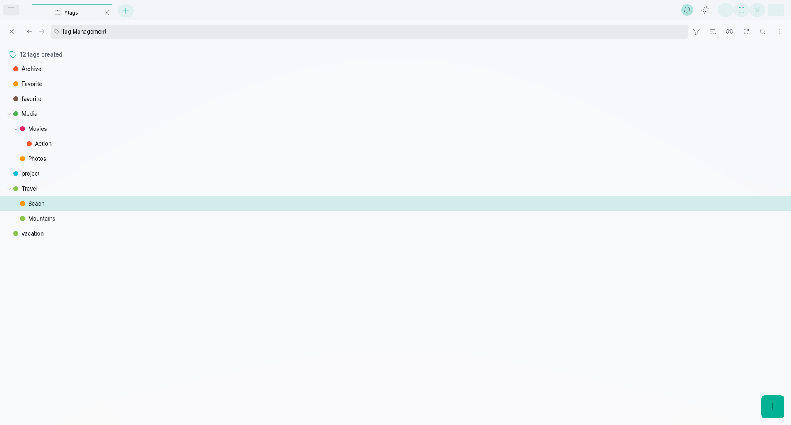
      <p align="center"><sub>Parent and child tag hierarchy</sub></p>
    </td>
    <td align="center" width="50%">
      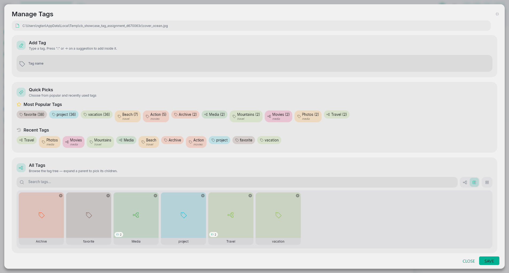
      <p align="center"><sub>Assign tags directly from a file context menu</sub></p>
    </td>
  </tr>
  <tr>
    <td align="center" width="50%">
      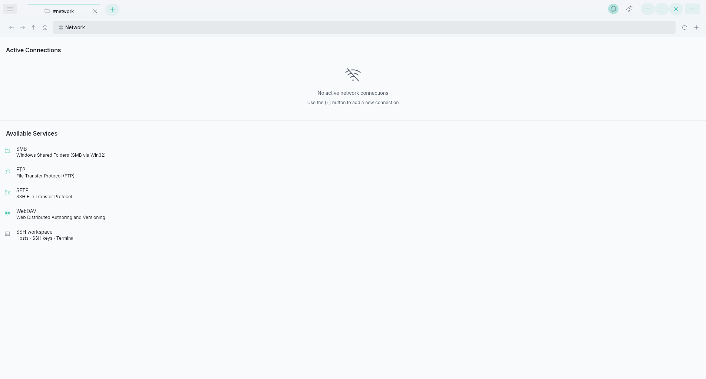
      <p align="center"><sub>Network connections with SMB, WebDAV, FTP, and SFTP services</sub></p>
    </td>
    <td align="center" width="50%">
      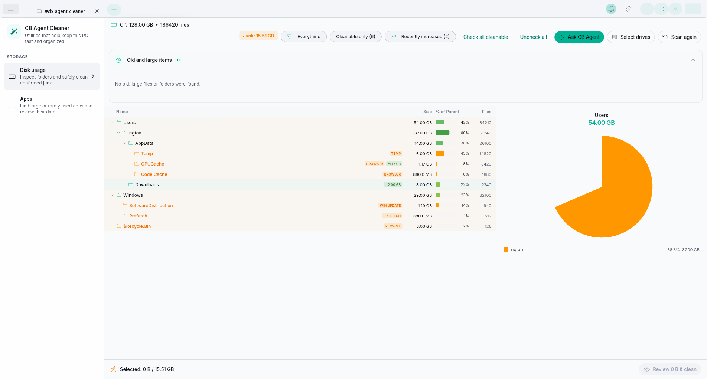
      <p align="center"><sub>Disk cleaner results and review workflow</sub></p>
    </td>
  </tr>
</table>

### Torrent library and downloads

<table>
  <tr>
    <td width="50%">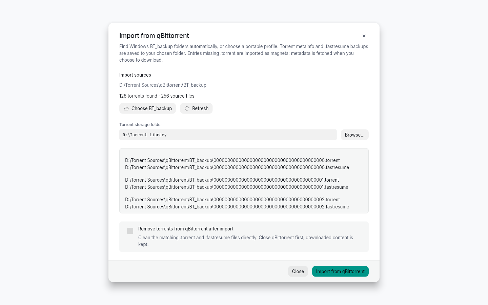<p>Import qBittorrent backups and review optional source cleanup.</p></td>
    <td width="50%">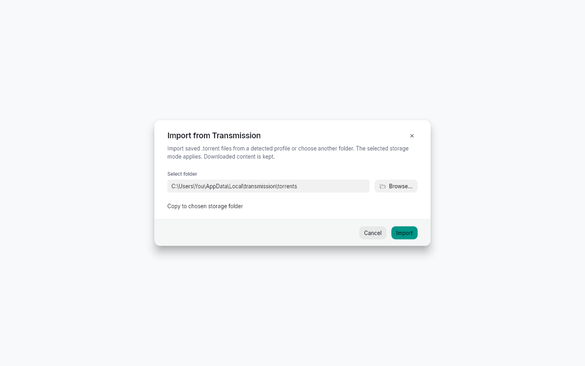<p>Import other clients from a detected profile or a custom folder.</p></td>
  </tr>
  <tr>
    <td width="50%">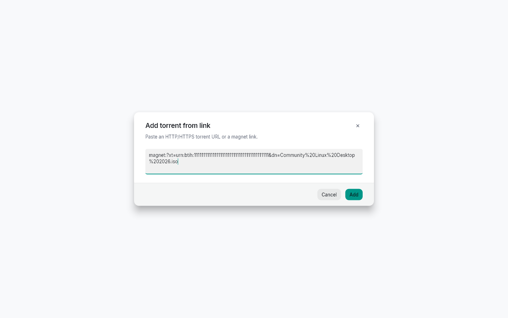<p>Open Add link with a valid clipboard magnet filled in.</p></td>
    <td width="50%">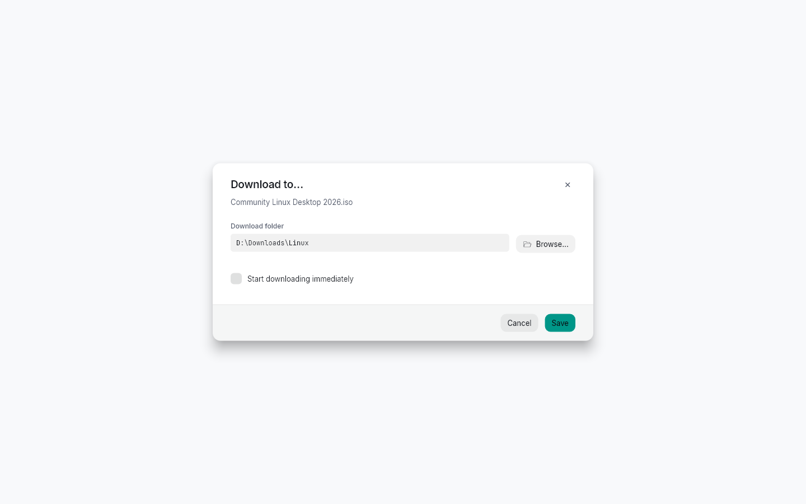<p>Choose the download folder and whether to start immediately.</p></td>
  </tr>
</table>

These images render the production Flutter dialogs with sample data. [Vietnamese previews](README.vi.md#thư-viện-torrent-và-tải-xuống) are also available.

### Mobile workflow

<table>
  <tr>
    <td align="center" width="50%">
      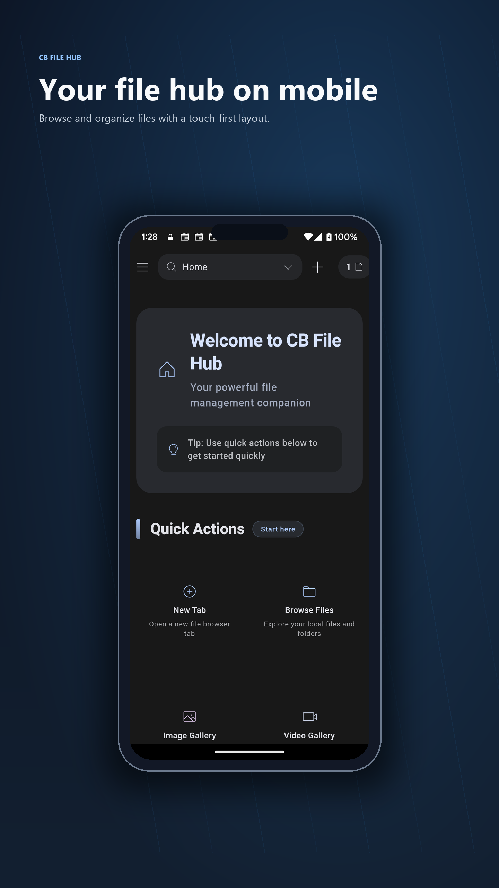
      <p align="center"><sub>Mobile home</sub></p>
    </td>
    <td align="center" width="50%">
      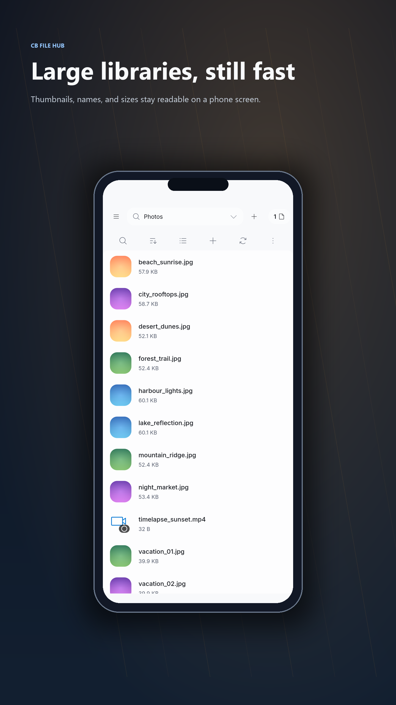
      <p align="center"><sub>File grid</sub></p>
    </td>
  </tr>
  <tr>
    <td align="center" width="50%">
      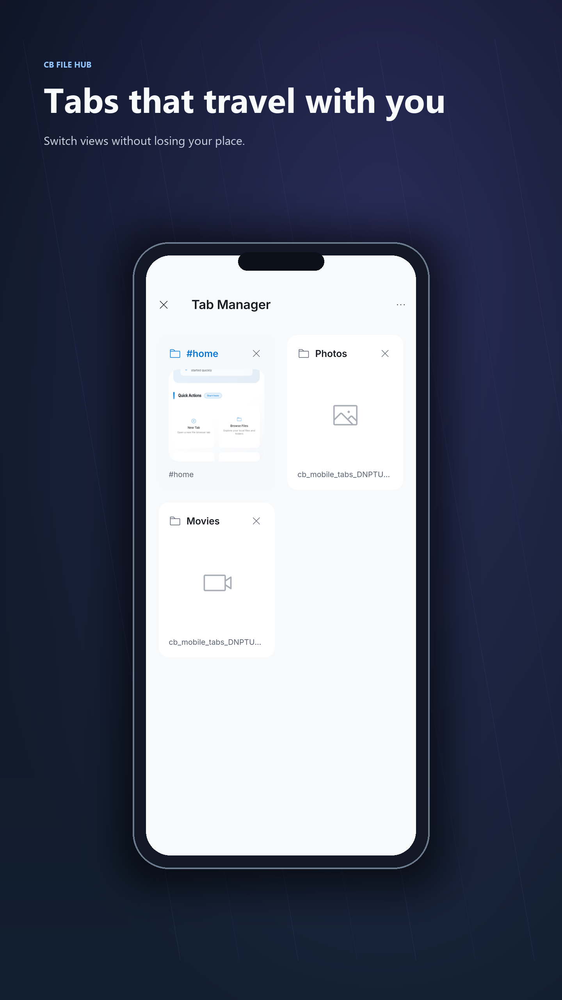
      <p align="center"><sub>Tabs and saved locations</sub></p>
    </td>
    <td align="center" width="50%">
      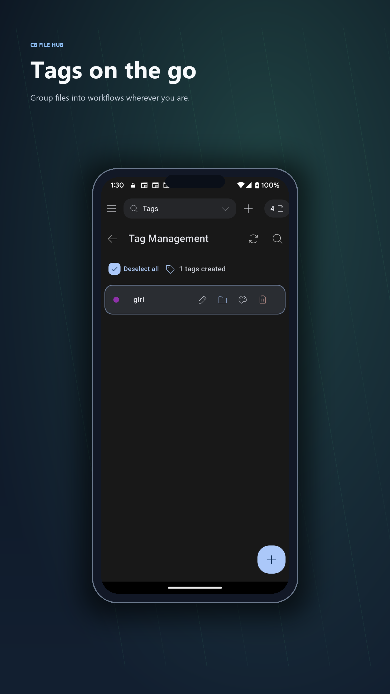
      <p align="center"><sub>Tags and tag browsing</sub></p>
    </td>
  </tr>
</table>

[More screenshots](screenshots/) · [Torrent guide](docs/features/10-torrent-library.md) · [AI Agent guide](docs/features/05-ai-agent.md)

## Quick Start

Install the app for your platform, open a folder, and pin your favorite locations. Follow the [installation guide](docs/guides/04-installation.md) for platform-specific steps, including macOS permissions and Linux setup.

## Development

Use **Flutter 3.47.8 stable** and `just`:

```bash
git clone https://github.com/coolbirdzik/cb-file-hub.git
cd cb-file-hub
just deps
```

Run `just` recipes from the repository root and direct Flutter/Dart commands from `cb_file_manager/`. See [development setup](docs/contributing/04-development-setup.md) for platform toolchains, builds, tests, and screenshot automation.

## Contributing

[Open an issue](https://github.com/coolbirdzik/cb-file-hub/issues) for bugs or feature requests, or submit a pull request. Read the [contribution guide](docs/contributing/01-contribution-guide.md) and [technical documentation](docs/technical/index.md) to get started.
