# CB File Hub

**Your ALL-IN-ONE file manager for Windows, macOS, Linux, and Android.**

[English](README.md) | [Tiếng Việt](README.vi.md)

<p align="center"></p>

CB File Hub là ứng dụng quản lý tập tin đa nền tảng dành cho thư viện dữ liệu lớn. Ứng dụng kết hợp duyệt tập tin, tab, tag, album, quản lý và tải torrent, xem/chỉnh sửa đa phương tiện, truy cập mạng/SSH, sao lưu cài đặt và tag, dọn ổ đĩa cùng trợ lý AI trong một không gian làm việc.

- [Tải từ Microsoft Store](https://apps.microsoft.com/detail/9nchpzkc4m5c)
- [Tải từ Google Play](https://play.google.com/store/apps/details?id=com.cbv.filehub)
- [Các bản phát hành](https://github.com/coolbirdzik/cb-file-hub/releases/latest)
- [Website coolbird.net](https://coolbird.net)

## Tính năng nổi bật

- **[Phụ đề AI chạy local trên desktop](#phụ-đề-ai-chạy-local-trên-desktop):** nhận diện lời nói, dịch phụ đề khi xem video, quản lý model và lưu cache cho lần sau.
- **Duyệt tập tin linh hoạt:** nhiều tab, chia đôi, ghim vị trí, khôi phục phiên và các chế độ xem quen thuộc.
- **Thư viện torrent:** index chung, nơi lưu tùy chọn, nhập từ ứng dụng khác, hợp nhất mục trùng và quản lý tải xuống.
- **Ảnh, video và âm thanh:** thư viện trực quan, hình thu nhỏ, trình xem, chỉnh sửa ảnh và trình phát tích hợp.
- **[Tự chọn thời điểm lấy thumbnail video](#tự-chọn-thời-điểm-lấy-thumbnail-video):** chọn ảnh đại diện từ mốc 10%, 20%, 50% hoặc vị trí khác trong video.
- **Tag và album:** tag cha/con, tìm theo nhiều tag, album thủ công và album thông minh theo quy tắc.
- **Tập tin mạng và SSH:** SMB, FTP, SFTP, WebDAV, hồ sơ SSH, khóa và terminal.
- **CB Agent:** tìm tập tin bằng ngôn ngữ tự nhiên, đề xuất tổ chức và hỗ trợ đánh giá trước khi dọn dẹp.
- **Disk Cleaner (Windows, macOS, Android):** xem thư mục lớn, file tạm, bộ nhớ đệm và chọn chính xác mục cần xử lý.
- **[Dung lượng ứng dụng](#dung-lượng-ứng-dụng):** xem mỗi ứng dụng đang chiếm gì trên đĩa (bản thân ứng dụng, cache, log, dữ liệu, extension của editor) và phần nào xoá an toàn.
- **Tăng tốc bằng Rust:** quét ổ đĩa, tìm kiếm, tạo ảnh thu nhỏ, tính hash và xử lý file nén trên luồng native. Xem [số đo hiệu năng](#hiệu-năng-với-rust).
- **Sao lưu và cá nhân hóa:** sao lưu cài đặt/tag, các tích hợp đám mây khả dụng, giao diện sáng/tối và màu nhấn.

## Phụ đề AI chạy local trên desktop

**Tạo và dịch phụ đề khi xem video, với cả nhận diện lẫn dịch chạy ngay trên máy tính của bạn.** Chọn ngôn ngữ muốn đọc hoặc mặc định theo ngôn ngữ app; có tiếng Nhật, Việt, Anh và các ngôn ngữ được model hỗ trợ.

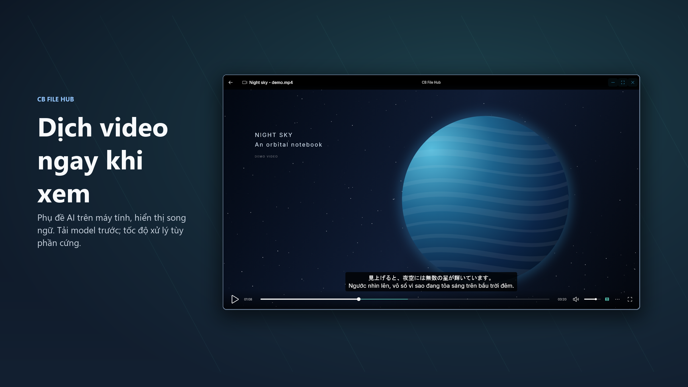

- **Xử lý tại máy:** tải Whisper và model dịch một lần; sau đó có thể tạo phụ đề cho video cục bộ khi offline. Không gửi audio hay bản chép lời đến dịch vụ AI đám mây.
- **Ngay trong controls:** một thanh seek hiển thị tiến độ phát và AI. Nút **CC** chứa trạng thái, cài đặt, thử lại và **Xóa và tạo lại**.
- **Quản lý model chung:** model nhận diện, dịch và CB Agent ở **Cài đặt → Model AI · CB Agent & phụ đề**, có tải, hủy, xóa và chuyển nơi lưu.
- **Lưu cho lần sau:** phụ đề hoàn tất được cache trong SQLite, dùng lại khi mở hoặc tua video; có thể chủ động xóa cache từng video hoặc toàn bộ.

**Bản xem trước desktop:** cần bản desktop có tính năng này và model đã tải. Các bản phát hành cũ có thể chưa có. Hỗ trợ video cục bộ và VOD mạng có timeline tua được; chưa hỗ trợ live stream không tua được. Tốc độ phụ thuộc phần cứng và model. Xem [hướng dẫn model và cache](docs/features/12-local-ai-subtitles.md).

<details><summary>Model, ngôn ngữ và cache phụ đề</summary>

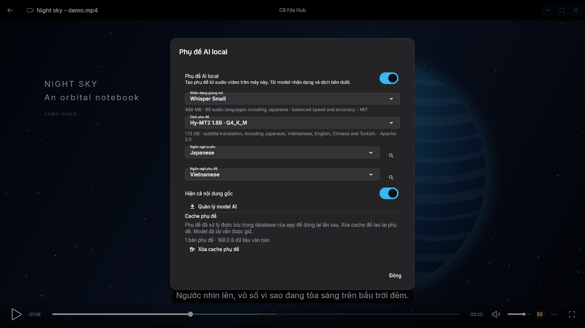

</details>

Ảnh dựng từ widget thật của app với hình minh họa và dữ liệu phụ đề mẫu, dùng để giới thiệu giao diện; không phải phép đo độ chính xác hay hiệu năng AI. [Tạo lại ảnh chụp và ảnh promo](screenshots/features/local_subtitles/README.md).

## Tự chọn thời điểm lấy thumbnail video

**Bạn quyết định thumbnail hiển thị khung hình ở thời điểm nào trong video:** 10%, 20%, 50% hoặc một tỷ lệ khác của tổng thời lượng. Ví dụ, chọn 20% cho video dài 10 phút thì ảnh đại diện được lấy ở khoảng phút thứ 2.

Vào **Cài đặt → Hình thu nhỏ video → Tùy chỉnh**, rồi chỉnh **Vị trí hình thu nhỏ** để chọn đoạn xuất hiện trên ảnh đại diện. Chế độ **Nhanh** dùng phương thức tạo thumbnail có sẵn của hệ điều hành. Bạn cũng có thể điều chỉnh số tác vụ tạo thumbnail song song.

Mặc định, ứng dụng chỉ tạo thumbnail cho video đang thấy và một ít mục lân cận, giúp giảm việc dùng CPU và đọc ổ đĩa ở thư viện lớn. Khi cuộn ra xa hoặc ẩn tab, các yêu cầu ngoài vùng này còn chờ sẽ được hủy; lượt đang giải mã được chạy nốt. Thumbnail đã có cache được dùng lại khi quay về. Tắt **Chỉ tải thumbnail gần vùng đang xem** nếu muốn tạo trước cho toàn bộ danh sách. [Chi tiết cơ chế tạo thumbnail](docs/technical/06-filesystem-media.md#hybrid-thumbnail-generation).

## Hiệu năng với Rust

CB File Hub dùng các luồng Rust để quét ổ đĩa, liệt kê và tính dung lượng thư mục, tìm kiếm đệ quy, tạo ảnh thu nhỏ và chỉnh sửa ảnh, tính hash, xử lý file nén và trích xuất văn bản tài liệu.

**Quét lại toàn bộ nhanh hơn TreeSize Free 3,3× trong benchmark 100.000 file:**

| Ứng dụng | Công nghệ quét | Quét lại toàn bộ 100.000 file | Tốc độ tương đối |
|----------|----------------|-----------------------------:|----------------:|
| **CB File Hub** | Luồng Rust + duyệt thư mục qua Win32 | **84,9 ms** | **3,3×** |
| TreeSize Free 4.8.1.609 | NTFS MFT / duyệt hệ thống file bằng 2 luồng¹ | 283,3 ms | 1,0× (mốc so sánh) |

Đo ngày 22/10/2026: Core i5-14600K, SSD NVMe, Windows 11; lấy trung vị 5 lượt chạy xen kẽ sau khi khởi động, với cache hệ điều hành đã được làm nóng. CB dùng màn hình Cleaner thật trong bản release chạy benchmark riêng. Hai bên cùng đếm đúng 100.000 file và 12.800.000 byte dữ liệu. Kết quả áp dụng cho luồng quét thư mục trên bộ dữ liệu tổng hợp này; hiệu năng quét toàn ổ đĩa có thể khác. [Mốc tính thời gian, số đo gốc, ảnh kết quả và cách chạy lại](docs/quality/03-rust-benchmarks.md#folder-scan-ui-comparison-with-treesize-free).

¹ Công nghệ của TreeSize được ghi theo [tài liệu JAM Software](https://www.jam-software.com/treesize/features.shtml); benchmark chưa xác định chính xác chiến lược nội bộ được TreeSize chọn trong lượt đo.

## Hình ảnh

<table>
  <tr>
    <td width="50%">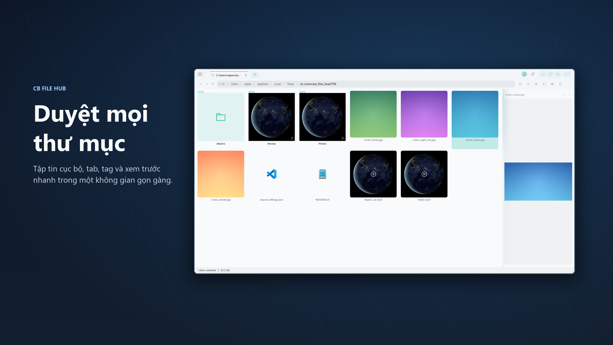<p>Duyệt tập tin với tab và hình thu nhỏ.</p></td>
    <td width="50%">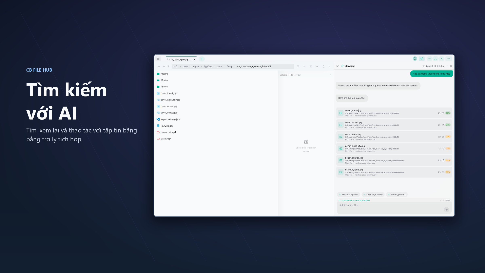<p>CB Agent hỗ trợ tìm kiếm cạnh trình duyệt tập tin.</p></td>
  </tr>
  <tr>
    <td width="50%">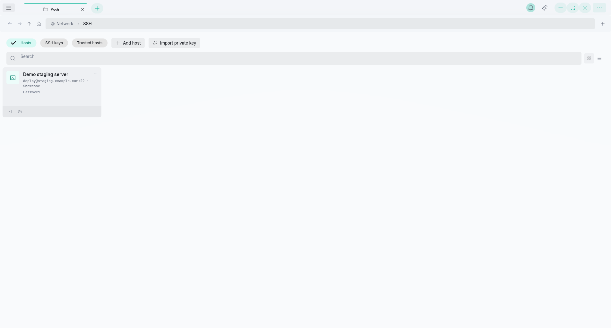<p>Máy chủ, khóa và kết nối SSH.</p></td>
    <td width="50%">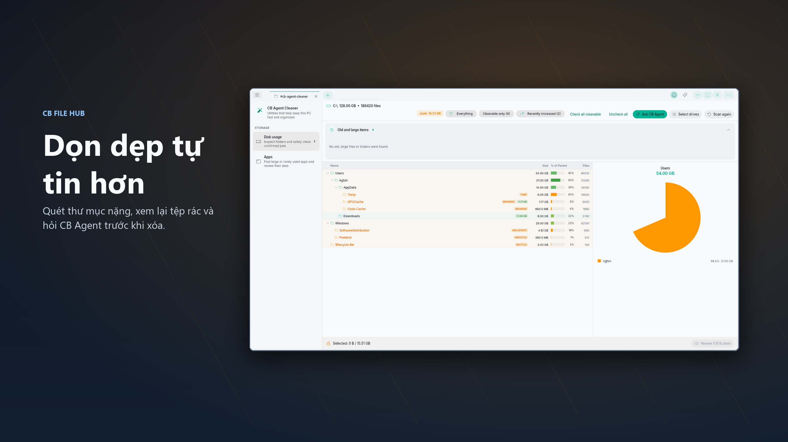<p>Xem kết quả quét và đánh giá trước khi dọn dẹp.</p></td>
  </tr>
</table>

### Thư viện torrent và tải xuống

<table>
  <tr>
    <td width="50%">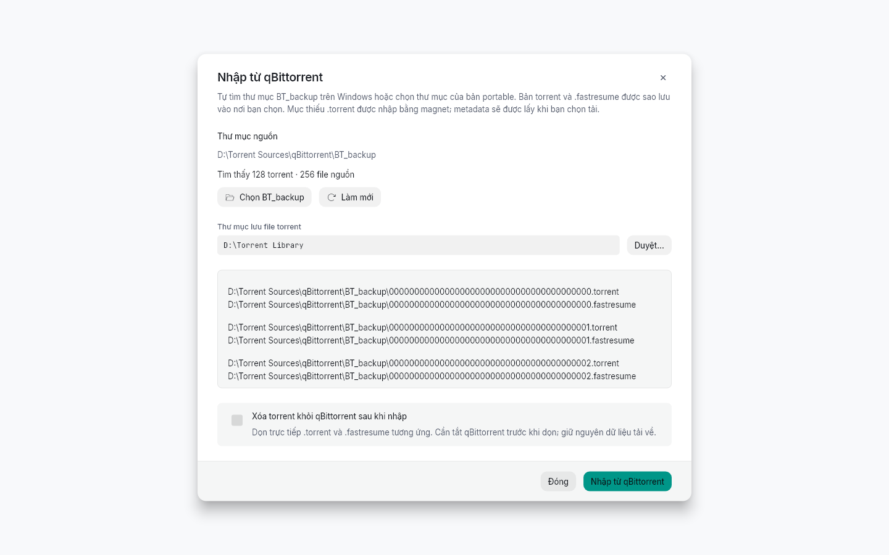<p>Nhập qBittorrent và xem tùy chọn dọn file nguồn.</p></td>
    <td width="50%">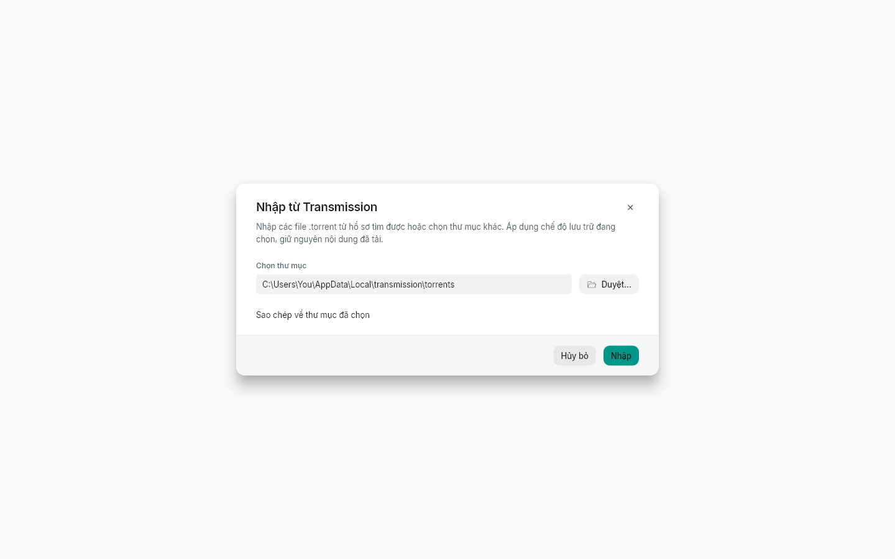<p>Nhập ứng dụng khác từ hồ sơ tìm được hoặc thư mục riêng.</p></td>
  </tr>
  <tr>
    <td width="50%">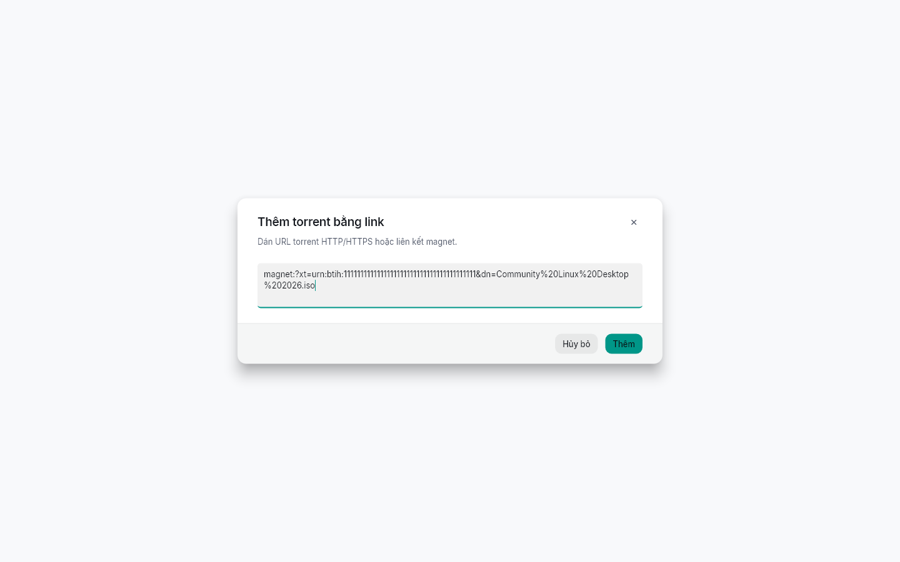<p>Tự điền magnet hợp lệ từ clipboard.</p></td>
    <td width="50%">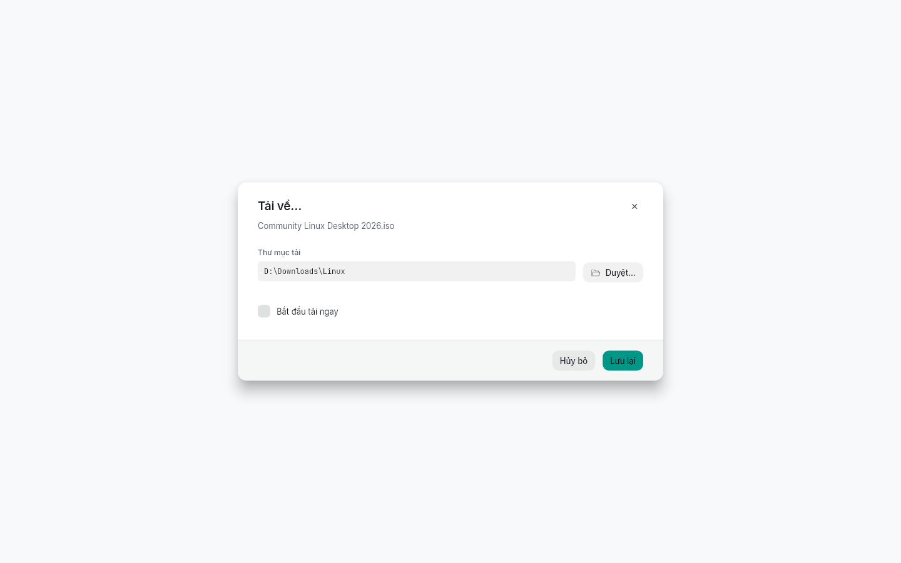<p>Chọn nơi lưu nội dung và có tải ngay hay không.</p></td>
  </tr>
</table>

Ảnh torrent được dựng từ các hộp thoại Flutter của ứng dụng với dữ liệu mẫu.

## Các chức năng

### Quản lý tập tin và không gian làm việc

- Duyệt dữ liệu cục bộ và vị trí mạng trong cùng giao diện.
- Mở nhiều tab, chia đôi khung xem, ghim thư mục/ổ đĩa và khôi phục phiên tab.
- Dùng chế độ danh sách, ô, lưới, chi tiết, cây và cột; các khung xem lớn tải mục theo nhu cầu.
- Tìm kiếm, dùng biểu thức chính quy, sắp xếp, chọn nhiều, kéo thả và phím tắt.
- Thực hiện các thao tác tạo, đổi tên, sao chép, di chuyển, xóa và xem thuộc tính.
- Theo dõi công việc đang chạy và cập nhật được hỗ trợ trong Trung tâm trạng thái.

### Torrent

- Lưu index chung trong khi file `.torrent` vẫn nằm ở nơi bạn chọn; hỗ trợ chế độ Chỉ index, Sao chép và Di chuyển.
- Duyệt thư viện lớn với tải theo nhu cầu, số file mỗi trang tùy chỉnh, các chế độ xem, tìm kiếm và sắp xếp.
- Nhấn F5 để quét nguồn, thêm torrent mới và bỏ qua nhanh file đã có.
- Thêm file `.torrent`, magnet hoặc URL torrent HTTP/HTTPS; tự điền magnet hợp lệ từ clipboard khi mở Thêm bằng liên kết.
- Chọn thư mục lưu nội dung tải xuống và có tải ngay hay không; ghi nhớ lựa chọn, tạm dừng, tiếp tục và dừng tác vụ.
- Trong cài đặt Torrent, có thể tắt hộp thoại tải để dùng thư mục và lựa chọn tải ngay đã lưu; nếu chưa có thư mục, ứng dụng hỏi để chọn lần đầu.
- Dùng lại tab Torrent khi mở magnet/file; các yêu cầu liên tiếp được xử lý lần lượt.
- Hỏi xác nhận khi trùng info hash; hợp nhất tracker và nguồn, giữ tác vụ cùng thư mục tải hiện tại.
- Nhập bản sao lưu qBittorrent, kể cả mục có thể khôi phục khi thiếu `.torrent` riêng. Tùy chọn dọn nguồn yêu cầu đóng qBittorrent và xác nhận; giữ nội dung đã tải.
- Nhập file `.torrent` đã lưu của µTorrent, BitTorrent, Transmission, Deluge hoặc thư mục portable/tùy chỉnh.
- Chuột phải để sao chép magnet cho một hoặc nhiều mục; xem tiến độ, tốc độ, seed, peer, tracker và các cột thông tin khác.
- Tải torrent trên máy tính dùng aria2, hỗ trợ BitTorrent v1/hybrid. Xem [hướng dẫn Torrent](docs/features/10-torrent-library.md) để biết chi tiết theo nền tảng.

### Ảnh, video và âm thanh

- Duyệt thư viện ảnh/video và hình thu nhỏ cho tập tin, thư mục, nội dung đa phương tiện.
- Chọn cách ảnh thu nhỏ vừa khung hoặc phủ khung; điều chỉnh vị trí lấy ảnh từ video.
- Xem ảnh và chỉnh sửa bằng cắt, xoay, lật, điều chỉnh màu sắc, bộ lọc và đánh dấu.
- Phát video/âm thanh cục bộ và từ nguồn mạng được hỗ trợ; chọn track âm thanh và phụ đề.
- Lấy khung hình video, dùng cửa sổ nổi hoặc cửa sổ phát riêng trên máy tính.

### Tag, tìm kiếm và album

- Gán tag từ menu tập tin, dùng lại tag gần đây/phổ biến và hiển thị tag trong các khung xem.
- Tạo cây tag cha/con, duyệt thư mục và cây dữ liệu với mục con tải theo nhu cầu.
- Tìm theo nhiều tag, lọc/sắp xếp tag và chuyển giữa danh sách, lưới, cây.
- Tạo album thủ công hoặc album thông minh theo quy tắc tên tập tin và thư mục nguồn đã chọn.

### Mạng và không gian SSH

- Kết nối SMB, FTP, SFTP, WebDAV; xem hình thu nhỏ và phát trực tiếp nội dung được hỗ trợ.
- Lưu thông tin kết nối cục bộ để kết nối lại thuận tiện.
- Quản lý hồ sơ SSH với mật khẩu hoặc khóa riêng, nhập khóa OpenSSH/PEM, tạo khóa và sao chép khóa công khai.
- Xác minh dấu vân tay máy chủ; xem cảnh báo rõ ràng khi khóa máy chủ thay đổi.
- Mở terminal tương tác, kết nối lại, xóa nội dung phiên và mở tập tin máy chủ qua SFTP trong tab hiện tại hoặc tab mới.

### Trợ lý AI

- Nhờ CB Agent tìm tập tin bằng ngôn ngữ tự nhiên và đề xuất tổ chức thư mục.
- Tạo tập tin/thư mục và thực hiện các thao tác quản lý qua luồng đề xuất, xác nhận phù hợp.
- Xem xét mục bất thường, nội dung trùng, tên khó hiểu, file đa phương tiện lỗi và mục đặt sai chỗ.
- Yêu cầu đánh giá một file/thư mục trước khi dọn dẹp, với ngữ cảnh về đường dẫn, dung lượng và phân loại.
- Chọn nhà cung cấp AI được hỗ trợ hoặc mô hình GGUF tương thích để chạy trên thiết bị. Khả năng phụ thuộc cấu hình và mô hình.

### Disk Cleaner (Windows, macOS, Android)

- Quét thư mục lớn, file tạm, bộ nhớ đệm trình duyệt, Thùng rác và các mục có thể dọn dẹp.
- Duyệt cây kết quả linh hoạt, chọn theo mục hoặc danh mục và nhờ CB Agent đánh giá.
- Trang **Ứng dụng** có trên Windows, macOS và Linux: dung lượng từng ứng dụng đã cài, lần mở gần nhất (Windows qua lịch sử chạy, macOS qua Spotlight; Linux chưa có) và nút gỡ (Windows qua trình gỡ của ứng dụng, macOS chuyển ứng dụng vào Thùng rác; Linux chưa hỗ trợ).
- Dùng Thùng rác cho thao tác được hỗ trợ; kiểm tra đường dẫn lỗi và kết quả dọn dẹp.

### Dung lượng ứng dụng

Trang **Dung lượng ứng dụng** trong Cleaner liệt kê mọi ứng dụng đã cài. Với mỗi ứng dụng, trang cho biết nó đang chiếm gì trên đĩa: bản thân ứng dụng, cache, log, báo cáo lỗi, web storage và dữ liệu riêng, cùng phần nào xoá được an toàn. Có trên Windows, macOS và Linux. Thư mục được gán cho ứng dụng theo cùng quy tắc với trang Dữ liệu ứng dụng còn sót, nên thư mục không thuộc ứng dụng nào đã cài vẫn nằm ở trang đó.

- **Dọn an toàn, đã tick sẵn:** cache mà ứng dụng tự tạo lại khi mở (ứng dụng Chromium/Electron như Slack, Teams, Discord, editor), log của các phiên trước và file crash cũ.
- **Tự chọn:** toàn bộ thư mục `Caches/<ứng dụng>` hoặc thư mục log. Ứng dụng sẽ tải hoặc tạo lại, nhưng có thể mở chậm hơn.
- **Chỉ để xem, không cho dọn:** tài liệu, container sandbox, dữ liệu dùng chung giữa các ứng dụng cùng hãng, web storage và cài đặt.
- **Ứng dụng đang chạy:** cache được giữ lại. Trên macOS và Linux, việc ứng dụng đang chạy được nhận ra qua danh sách tiến trình; trên Windows, qua tên file chạy của ứng dụng.
- **Trình soạn thảo code:** VS Code, Cursor, VSCodium, Windsurf, Antigravity và Kiro còn liệt kê từng extension kèm icon, dung lượng cài đặt và dữ liệu, cùng bản extension cũ và dữ liệu của workspace đã xoá.
- **Docker:** image, container, volume và build cache, đọc qua chính CLI của Docker. Build cache và image không có tag được tick sẵn. Image không dùng và container đã dừng là tự chọn; volume không dùng cũng là tự chọn, kèm cảnh báo dữ liệu sẽ bị xoá vĩnh viễn. Docker tự xoá các mục này sau khi bạn xác nhận; không có gì được chuyển vào Thùng rác.

<p align="center">
  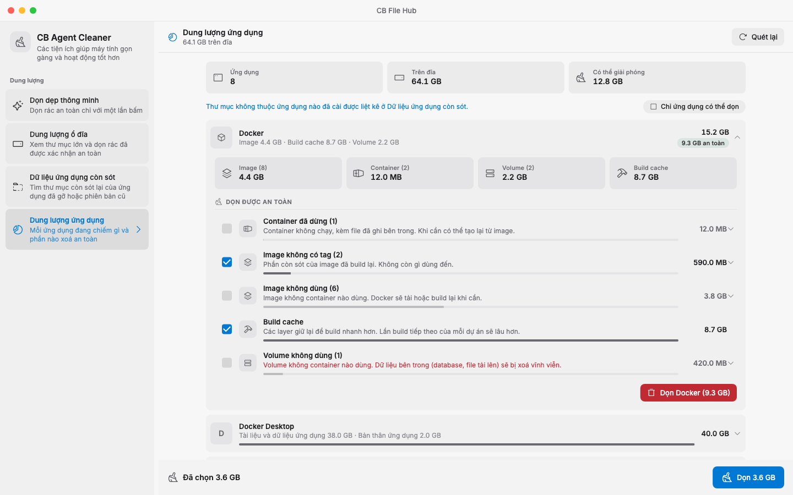
</p>

Kết quả hiện ngay khi đo xong các thư mục dữ liệu; dung lượng của bản thân từng ứng dụng hiện sau. Dung lượng thư mục được đo bằng một lần quét Rust, có bản Dart dự phòng. Mọi mục được dọn đều được chuyển nguyên thư mục vào Thùng rác.

<table>
  <tr>
    <td width="33%">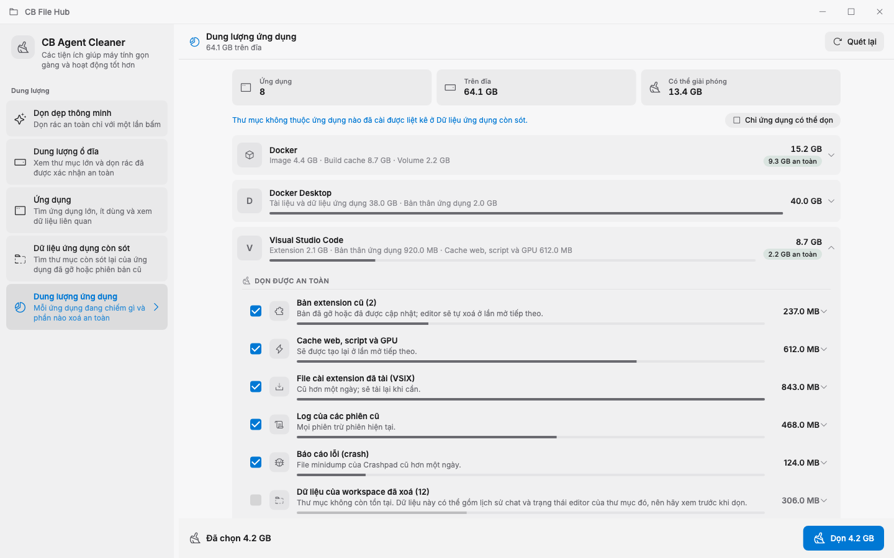<p align="center">Windows</p></td>
    <td width="33%">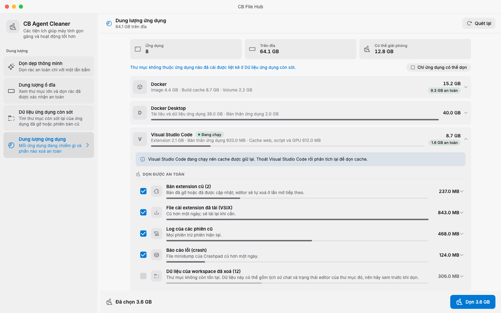<p align="center">macOS</p></td>
    <td width="33%">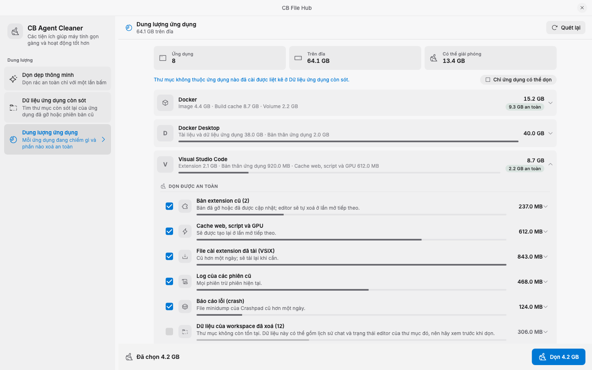<p align="center">Linux</p></td>
  </tr>
</table>

### File nén, sao lưu và cá nhân hóa

- Duyệt nội dung file nén như thư mục; trích xuất mục đã chọn hoặc toàn bộ.
- ZIP, 7z, TAR (cả .tar.gz, .tar.bz2, .tar.xz), GZip và BZip2 dùng được trên Windows, macOS, Linux và Android mà không cần cài thêm công cụ.
- RAR cần cài 7-Zip nên hiện chỉ dùng được trên Windows.
- Xuất và khôi phục cài đặt/tag bằng gói ZIP.
- Sao lưu lên các tích hợp Google Drive, Dropbox, OneDrive khả dụng qua tài khoản của bạn, kể cả nhiều dịch vụ cùng lúc.
- Chọn sáng/tối, màu nhấn, chế độ xem mặc định, khung xem trước và tùy chọn ảnh thu nhỏ.
- Bản Microsoft Store dùng cơ chế cập nhật của Store; các bản phân phối được hỗ trợ khác có luồng cập nhật riêng.

## Nền tảng và bắt đầu sử dụng

Disk Cleaner: **Windows, macOS, Android**.

Windows, Android, Linux và macOS có các bản phân phối phù hợp. Một số tính năng phụ thuộc nền tảng: tải torrent hiện dành cho máy tính. Kết nối mạng, sao lưu đám mây, nhà cung cấp AI và mô hình cục bộ có thể cần tài khoản hoặc thiết lập riêng.

Tải bản phù hợp từ [Releases](https://github.com/coolbirdzik/cb-file-hub/releases/latest), Microsoft Store hoặc Google Play. Mở một thư mục, chọn chế độ xem và ghim vị trí thường dùng. Dùng mục Torrent để nhập thư viện và chọn nơi lưu nội dung tải xuống.

Xem [hướng dẫn cài đặt và phát triển](README.md#quick-start), [tài liệu tính năng](docs/features/) và [quy trình gửi Microsoft Store](docs/guides/02-microsoft-store-submission-guide.md).

## Ảnh minh họa và nội dung hai store

Từ thư mục `cb_file_manager/`, dựng lại ảnh torrent tiếng Anh/Việt bằng dữ liệu mẫu:

```bash
flutter test --no-pub tool/capture_torrent_screenshots_test.dart --dart-define=CB_CAPTURE_SCREENSHOTS=true
```

Ảnh được ghi vào `screenshots/features/torrents/en/` và `vi/`; luồng này dựng widget, không mở ứng dụng desktop hay đọc thư viện torrent của người dùng.

Ảnh trang Dung lượng ứng dụng cho Windows, macOS và Linux được dựng theo cùng cách. Lệnh dưới đây ghi ảnh vào `screenshots/features/app_storage/en/` và `vi/`. Luồng này không đọc thư mục ứng dụng nào:

```bash
flutter test --no-pub tool/capture_app_storage_screenshots_test.dart --dart-define=CB_CAPTURE_SCREENSHOTS=true
```

Microsoft Store và Google Play dùng chung mô tả ngắn gọn tại [`store/listings/`](store/listings/), mỗi ngôn ngữ của app một bộ (Anh, Việt, Thổ Nhĩ Kỳ, Trung giản thể). Chỉ cần sửa file `.txt` của từng ngôn ngữ; các dòng gạch đầu dòng cũng tạo danh sách tính năng cho Microsoft Store. File `.json` bên cạnh chứa mô tả ngắn, mã ngôn ngữ Google Play và danh sách ảnh chụp/hero art cho Microsoft Store. CI kiểm tra giới hạn ký tự và kích thước ảnh, tạo artifact `store-listings`, rồi cập nhật nội dung (và ảnh với MSIX) khi submit MSIX/AAB. Xem [hướng dẫn nội dung](store/README.md).
